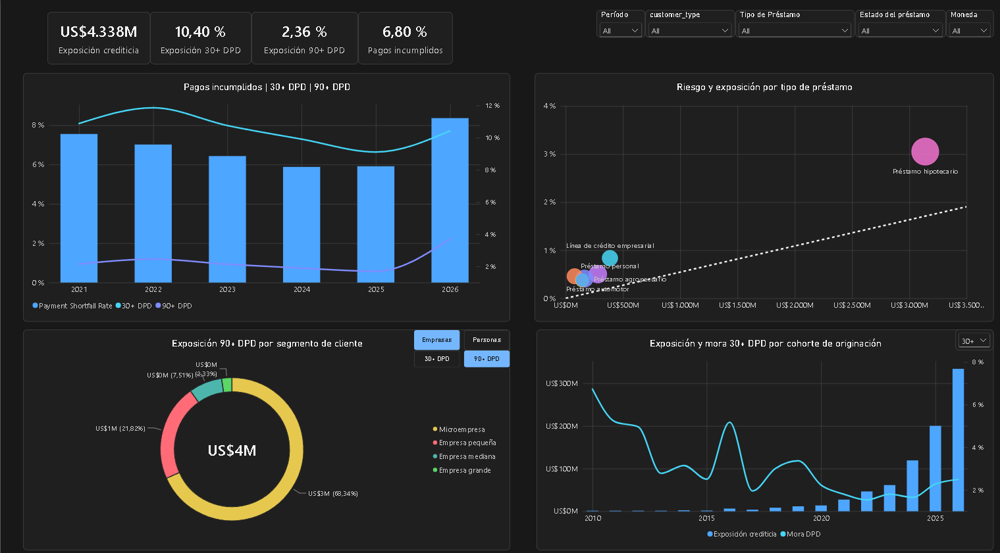
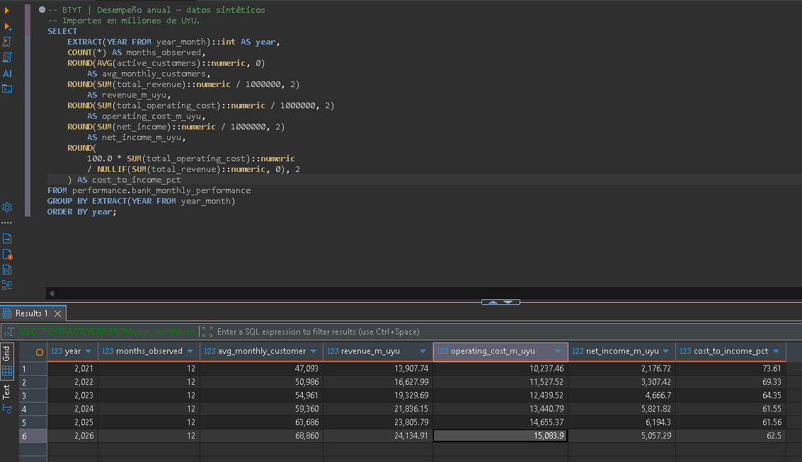
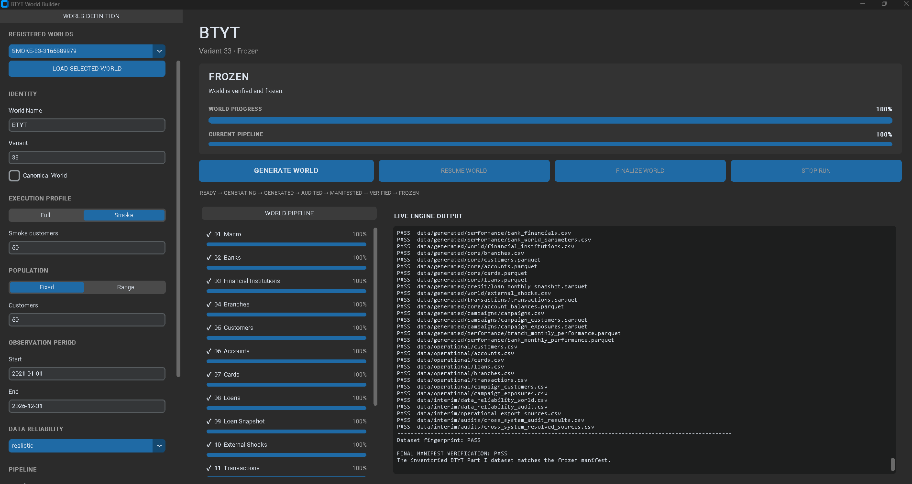

# BTYT Banking Analytics

**Banking data turned into financial performance, customer and credit-risk insights.**

An end-to-end portfolio project by **Santiago Castillo Marsicano · Economics & Sociology**. Built around a fictional Uruguayan commercial bank, BTYT connects a Python synthetic-data pipeline, PostgreSQL analytics and interactive Power BI reporting.

**Python · PostgreSQL · SQL · Power BI · DAX**  
**107K customers · 76.8M transactions · 37 branches · 2021–2026**

*Credit Risk dashboard — current development preview. All data and financial results are synthetic. DPD = days past due.*

[Explore the Power BI files](powerbi/) · [Browse SQL analysis](scripts/sql/exploration/) · [Read the documentation](docs/README.md)

## What can this project help analyze?

| Business question | Analytical approach |
|---|---|
| Is revenue growth translating into profit? | Monthly and annual revenue, operating costs, net income and cost-to-income analysis. |
| Where is credit exposure concentrated? | Loan-type comparisons, customer segmentation and delinquency indicators. |
| How does credit quality evolve? | Payment shortfalls, 30+ / 90+ DPD exposure and origination-cohort analysis. |
| How do branches and customer groups differ? | Branch performance reporting and customer/account analysis. |

## From business question to SQL result

The annual performance query summarizes **72 monthly observations** into six years of reporting. It averages monthly active customers, sums financial flows and calculates cost-to-income from annual totals.

**Example finding from the simulated bank:** revenue rises from UYU 23,805.79 million in 2025 to UYU 24,134.91 million in 2026, while net income falls from UYU 6,194.30 million to UYU 5,057.29 million. Cost-to-income increases from **61.56% to 62.50%**.

This creates a management question: **what explains the gap between revenue growth and profitability?** Answering it requires a breakdown of operating costs, credit losses and taxes; the annual summary alone does not establish the cause.

[View the performance SQL](scripts/sql/exploration/07_performance.sql)

## Python: building the analytical universe

BTYT includes a **World Builder application** to configure synthetic banking scenarios and manage their generation pipeline. The interface exposes world settings, execution stages, progress and verification output.

*Demonstration run: Smoke profile, 50 customers, variant 33. The interface reports FROZEN status and final manifest verification PASS. This is a separate test world, not the 107,253-customer analytical world used for BI.*

[Explore the application](world_builder/) · [Explore the generators](scripts/generators/) · [Explore validation scripts](scripts/audits/)

## How the pieces connect

**Python generation → Parquet / CSV → PostgreSQL → SQL analytical views → Power BI / DAX**

- **Python:** synthetic customers, products, transactions, credit histories and financial performance, with validation scripts and world-management tooling.
- **PostgreSQL:** 23 physical tables across seven schemas, relational constraints and reusable analytical views/materialized views.
- **SQL:** thematic analysis of customers, accounts, loans, transactions, branches, campaigns and bank performance.
- **Power BI:** semantic modeling, interactive filters, time intelligence and business-facing reporting.

Heavy transaction aggregations happen in PostgreSQL. The raw **76.8M-row transaction table is not imported directly into Power BI**.

## Current delivery status

| Area | Status |
|---|---|
| Synthetic data, relational model and SQL/KPI layer | Implemented; canonical analytical world available. |
| Executive Overview, Branches, Customers & Accounts | Functionally complete; visual polish ongoing. |
| Credit Risk | KPI layer implemented; dashboard preview shown above, visual refinement ongoing. |
| Remaining thematic dashboard pages | In progress / planned. |
| Excel, Tableau and focused Python analyses | Planned downstream extensions. |
| Part II — predictive credit-risk modeling | Planned; not presented as an implemented capability. |

The current portfolio focuses on **Part I — Business Intelligence & Performance Management**.

<strong>Technical detail: data scale, modeling and analytical safeguards</strong>

### Canonical data scale

World: `worlds/BTYT/01` · Observation window: January 2021–December 2026.

| Entity | Records / count |
|---|---:|
| Customers | 107,253 |
| Accounts | 228,945 |
| Cards | 297,775 |
| Loans | 233,441 |
| Loan-month snapshots | 4,109,490 |
| Transactions | 76,799,360 |
| Branches / agencies | 37 |

Generated datasets are kept outside normal Git history where appropriate. The screenshots provide a preview without requiring a local database or a full data-generation run.

### Relational model

| Schema | Tables | Purpose |
|---|---:|---|
| `core` | 4 | Customers, branches, products and accounts |
| `banking` | 5 | Cards, loans, transactions, balances and loan snapshots |
| `marketing` | 3 | Campaigns, targeting and exposure |
| `reference` | 2 | Campaign dimensions |
| `market` | 5 | Banks, institutions and market dynamics |
| `macro` | 2 | Macroeconomic environment and shocks |
| `performance` | 2 | Bank and branch monthly performance |

### Analytical safeguards

- **Grain:** transactions are individual events; balances and credit snapshots are account-month and loan-month observations; performance is bank-month or branch-month.
- **Stocks vs. flows:** balances require an explicit time rule; revenue, costs and other flows can be accumulated over a period.
- **Historical state:** master-record statuses represent cutoff attributes unless documented otherwise. Monthly snapshots support historical analysis.
- **Currency:** the performance schema stores UYU-equivalent reporting values. BI applies explicit reporting-currency conversion.
- **Transactions:** financial volume uses completed transactions; failed attempts remain operational events.
- **Campaigns:** a `POSITIVE` response indicates receptivity, not automatically product conversion. Segmentation alone is not an A/B experiment.
- **Financial logic:** net interest income plus fees produces revenue; operating costs, credit losses and taxes reconcile it to net income.
- **Validation scope:** the displayed World Builder verification applies to the smoke run. A separate full-world cross-system audit was interrupted by a memory limit during transaction/balance reconciliation; its successful preceding checks do not establish completion of that run.

## Explore the project

| Resource | Contents |
|---|---|
| [Documentation map](docs/README.md) | Entry point to project documentation |
| [SQL exploration](scripts/sql/exploration/) | Eight thematic analysis modules, `00–07` |
| [KPI catalog](docs/analytics/kpi_catalog.md) | Metric definitions and analytical ownership |
| [Power BI documentation](docs/powerbi/) | Semantic model, measures and report pages |
| [Database workflow](docs/dbprocess/) | PostgreSQL lifecycle and refresh process |
| [Data dictionary](docs/data_dictionary/) | Dataset definitions and semantics |
| [Credit-risk calibration](docs/analytics/credit_risk_calibration.md) | Credit-quality methodology |

**Power BI files:** `powerbi/BTYT_Banking_Analytics.pbix` is the main analytical file; `powerbi/BTYT PRESENTATION.pbix` is the presentation copy.

**Next phase:** Part II will reuse the banking universe for credit-risk modeling, with explicit target definitions, temporal train/validation/test splits, leakage controls and model evaluation.

---

**Author:** [Santiago Castillo Marsicano](https://github.com/SantiagoCMarsicano) · Economics & Sociology · Data Analytics & Business Intelligence

**Data disclaimer:** BTYT is fictional and all customer, transaction, financial and credit-event data is synthetic. No confidential banking information is used. Real institution names, where present, are structural references; associated synthetic values are not real reported results.
