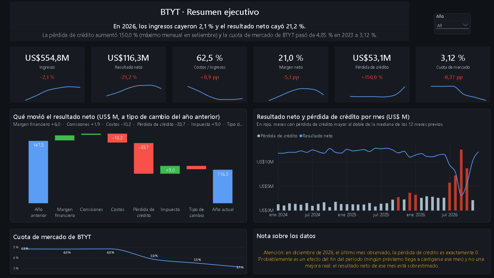
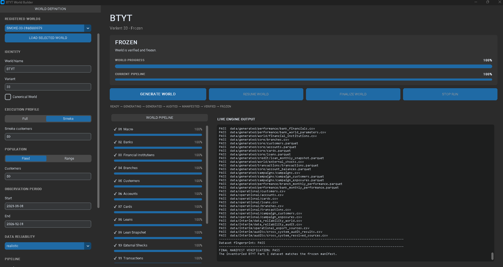
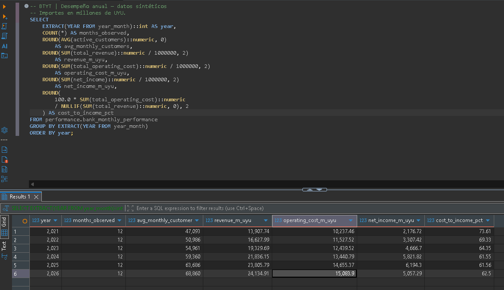
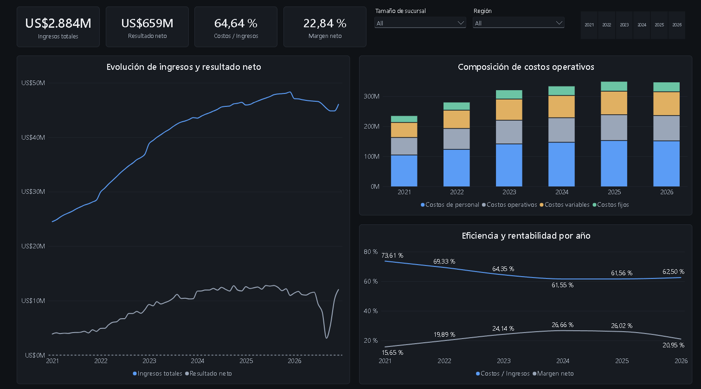
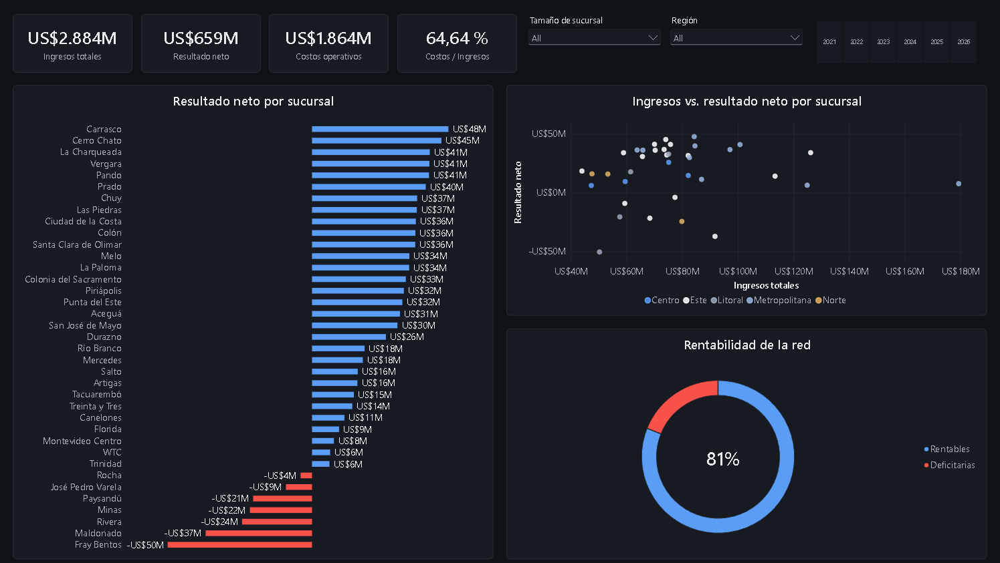
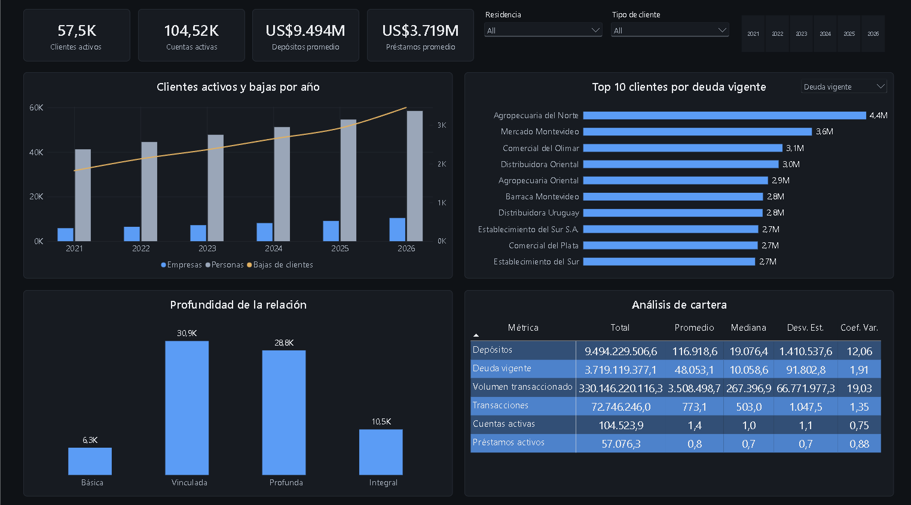
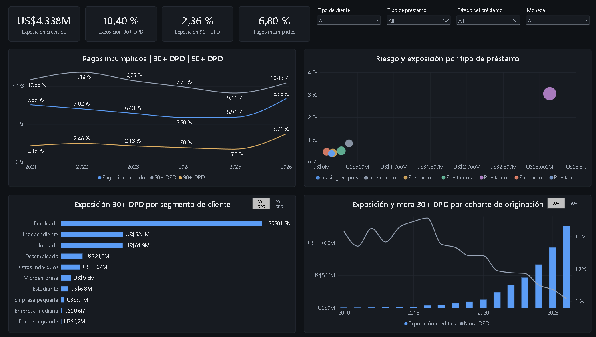
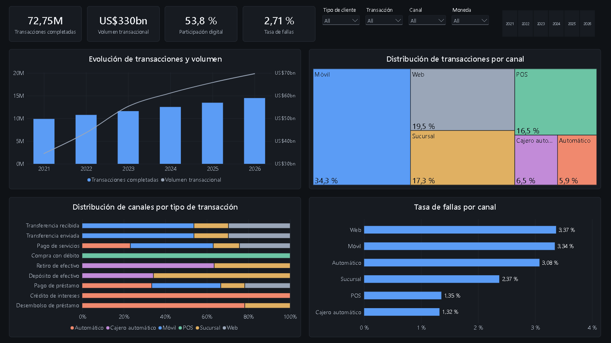
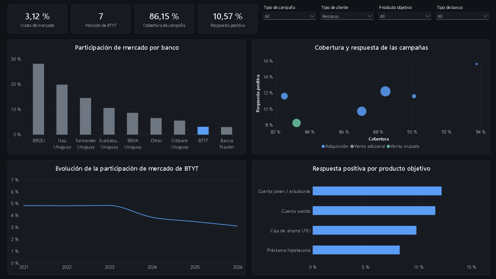

<p align="center">
  
</p>

<p align="center">
  <strong>Español</strong> · <a href="README_EN.md">Versión en inglés</a>
</p>

# BTYT Banking Analytics

**Proyecto integral de analítica bancaria basado en un banco comercial uruguayo ficticio.**

**Python · PostgreSQL · SQL · Power BI · DAX**

**107 mil clientes · 37 sucursales · 72,75 millones de transacciones completadas · 2021–2026**

> **Parte I — Inteligencia de negocios y gestión del desempeño:** implementación principal finalizada. Extensiones para Excel y Tableau previstas.

<p align="center">
  
</p>

BTYT es más que un tablero de indicadores. El proyecto construye un universo bancario sintético configurable y desarrolla todo su proceso analítico:

**World Builder → Generación y validación con Python → PostgreSQL → Análisis con SQL → Power BI**

Todos los datos de clientes, operaciones, resultados financieros y eventos crediticios son **sintéticos**.

---

## Arquitectura integral

```text
World Builder
      │
      ├── Configuración de mundos
      ├── Semillas reproducibles
      └── Gestión de escenarios
      │
      ▼
Generación con Python
      │
      ├── Clientes, cuentas y tarjetas
      ├── Préstamos e historiales crediticios
      ├── Transacciones y saldos
      ├── Sucursales y campañas
      └── Resultados financieros
      │
      ▼
Validación y auditoría
      │
      ▼
Archivos Parquet / CSV
      │
      ▼
PostgreSQL
      │
      ├── Modelo relacional
      ├── Vistas analíticas
      └── Agregaciones materializadas
      │
      ▼
Power BI + DAX
      │
      ├── Informes ejecutivos
      ├── Análisis del negocio
      └── Seguimiento del riesgo crediticio
```

El mismo universo bancario permite realizar análisis descriptivos en la Parte I y desarrollar modelos predictivos en la Parte II.

---

## Inicio rápido

El proceso de generación fue probado con **Python 3.14.7 en Windows 11**.

Clonar el repositorio y crear un entorno virtual:

```powershell
git clone https://github.com/SantiagoCMarsicano/btyt-banking-analytics.git
cd btyt-banking-analytics
python -m venv .venv
```

Activar el entorno, instalar las dependencias e iniciar World Builder:

```powershell
.\.venv\Scripts\Activate.ps1
python -m pip install -r requirements.txt
python -m world_builder.app
```

World Builder permite crear un mundo de prueba **SMOKE** con pocos clientes, ejecutar la generación y validar los resultados.

**[Guía detallada de World Builder](world_builder/README.md#quick-start)**

Para comprobar la configuración del mundo activo sin generar datos:

```powershell
python -m scripts.generate_btyt --check-only
```

No se necesita PostgreSQL para explorar el código, las consultas SQL, las medidas DAX o las capturas del informe. Para reproducir el proceso completo y actualizar Power BI sí se requiere una base de datos PostgreSQL compatible.

---

## 1. Python — Construcción del universo bancario

En lugar de utilizar una base de datos bancaria predefinida, BTYT genera clientes, cuentas, tarjetas, préstamos, transacciones, sucursales, campañas y resultados financieros relacionados entre sí.

**World Builder** permite configurar escenarios, gestionar semillas reproducibles, ejecutar el proceso de generación, auditar la consistencia de los datos y conservar mundos finalizados.

<p align="center">
  
</p>

El mundo canónico es una realización particular: la misma arquitectura permite generar otros escenarios bancarios sintéticos.

[World Builder](world_builder/) · [Generadores de Python](scripts/generators/) · [Scripts de auditoría](scripts/audits/)

---

## 2. PostgreSQL y SQL — De los datos al análisis

PostgreSQL almacena el universo bancario en tablas relacionales organizadas por áreas de negocio. La capa analítica incorpora consultas SQL reutilizables, vistas, agregaciones materializadas, indicadores bancarios y controles de consistencia.

<p align="center">
  
</p>

Los grandes volúmenes de transacciones se agregan previamente en PostgreSQL para analizar los resultados sin importar decenas de millones de operaciones individuales a Power BI.

[Consultas de análisis](scripts/sql/exploration/) · [Vistas analíticas](scripts/sql/views/) · [Proceso de base de datos](docs/dbprocess/)

---

## 3. Power BI — Inteligencia de negocios

Power BI es la principal herramienta de análisis y presentación de resultados implementada en la Parte I.

El informe contiene **siete páginas**: un resumen ejecutivo y seis secciones temáticas. Su modelo semántico incluye **107 medidas DAX documentadas**, una dimensión temporal, un grupo de cálculo para comparaciones entre períodos y reglas de conversión monetaria por año.

El proyecto se conserva en formato **`.pbip`**, con las definiciones de las páginas en PBIR (JSON) y las del modelo semántico en TMDL, lo que permite revisar su contenido directamente en Git.

### 01 — Resumen ejecutivo

Resultados de cierre anual, interpretación automática, indicadores interanuales, descomposición del resultado neto, seguimiento de pérdidas crediticias y evolución de la cuota de mercado.

<p align="center">
  
</p>

### 02 — Rentabilidad y costos

Evolución de ingresos y resultado neto, composición de costos operativos, eficiencia y márgenes de rentabilidad.

<p align="center">
  
</p>

### 03 — Sucursales

Rentabilidad por sucursal, resultados financieros, comparaciones regionales y eficiencia de la red.

<p align="center">
  
</p>

### 04 — Clientes y cuentas

Evolución de clientes, relaciones bancarias, depósitos, créditos y distribución de las carteras.

<p align="center">
  
</p>

### 05 — Riesgo de crédito

Exposición crediticia, morosidad de 30 o más y 90 o más días, faltantes de pago, segmentos de clientes y cohortes de originación.

<p align="center">
  
</p>

### 06 — Transacciones y canales

Transacciones completadas, volumen expresado en USD, participación de canales digitales y tasas de operaciones fallidas.

<p align="center">
  
</p>

### 07 — Mercado y campañas

Posicionamiento competitivo, cuota de mercado, cobertura de campañas y respuestas positivas de clientes.

<p align="center">
  
</p>

### Archivos de Power BI

Se mantienen dos formatos complementarios:

| Formato | Uso |
|---|---|
| **`.pbip`** | Proyecto fuente editable, con páginas PBIR y modelo semántico TMDL |
| **`.pbix`** | Archivo de Power BI Desktop, gestionado mediante Git LFS |

El proyecto se abre desde `powerbi/BTYT_Banking_Analytics.pbip`, junto con las carpetas `.Report` y `.SemanticModel`. También se incluye `powerbi/BTYT_Banking_Analytics.pbix` como archivo de Power BI Desktop.

Para actualizar los datos de cualquiera de los dos formatos se requiere acceso a la fuente PostgreSQL.

[Documentación de Power BI](docs/powerbi/)

---

## Criterios analíticos

- **Flujos:** ingresos, costos y transacciones se acumulan en el período analizado.
- **Saldos:** depósitos, balances y exposición crediticia utilizan criterios de cierre mensual.
- **Moneda:** los importes en pesos uruguayos se convierten a USD según el tipo de cambio correspondiente a cada año.
- **Transacciones:** se separan las operaciones completadas de las fallidas.
- **Riesgo crediticio:** se distinguen morosidad, exposición y pérdidas crediticias.
- **Campañas:** una respuesta positiva indica receptividad, no necesariamente un efecto causal.

---

## Tecnologías utilizadas

| Componente | Tecnología |
|---|---|
| Generación de datos sintéticos | Python |
| Gestión de mundos | CustomTkinter |
| Almacenamiento | Parquet / CSV |
| Base de datos | PostgreSQL |
| Procesamiento analítico | SQL |
| Modelado e inteligencia de negocios | Power BI / DAX / TMDL |
| Validación y auditoría | Python / SQL |
| Control de versiones | Git / GitHub |
| Distribución de informes | PBIP / PBIX / Git LFS |
| Extensiones previstas | Excel / Tableau |

---

## Documentación

[World Builder](world_builder/README.md) ·
[Power BI](docs/powerbi/) ·
[Catálogo de indicadores](docs/analytics/kpi_catalog.md) ·
[Análisis SQL](scripts/sql/exploration/) ·
[Diccionario de datos](docs/data_dictionary/) ·
[Proceso de base de datos](docs/dbprocess/) ·
[Documentación general](docs/README.md)

---

## Hoja de ruta

### Parte I — Inteligencia de negocios y gestión del desempeño

**Implementación principal finalizada:** generación sintética con Python → PostgreSQL → análisis SQL → Power BI.

**Extensiones previstas:** Excel y Tableau, reutilizando el mismo universo bancario y catálogo de indicadores.

### Parte II — Riesgo de crédito y analítica predictiva

Ingeniería de variables → validación temporal → modelos estadísticos y de aprendizaje automático → evaluación → explicabilidad → interpretación para la toma de decisiones.

La Parte II reutilizará el universo bancario existente, sin incorporar una base de datos independiente.

---

## Autor

**Santiago Castillo Marsicano**

Licenciado en Economía y Sociología · Análisis de datos · Inteligencia de negocios

[Perfil de GitHub](https://github.com/SantiagoCMarsicano)

---

> **Aviso:** BTYT es un banco ficticio. Todos los datos de clientes, transacciones, resultados financieros, riesgo crediticio, mercado y campañas son sintéticos. No se utiliza información bancaria confidencial.
