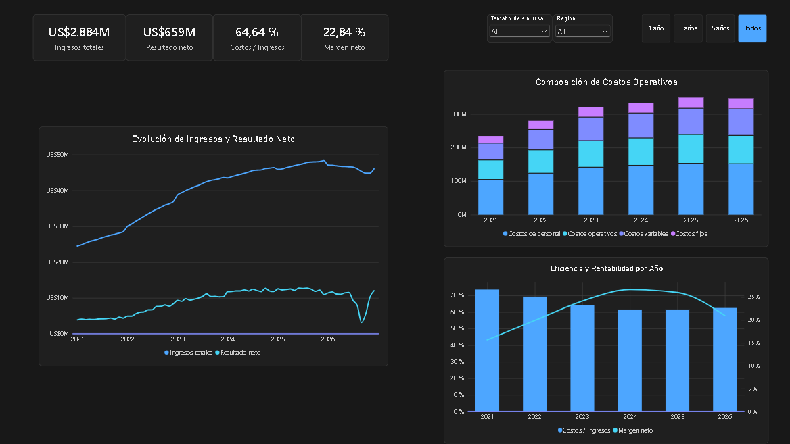
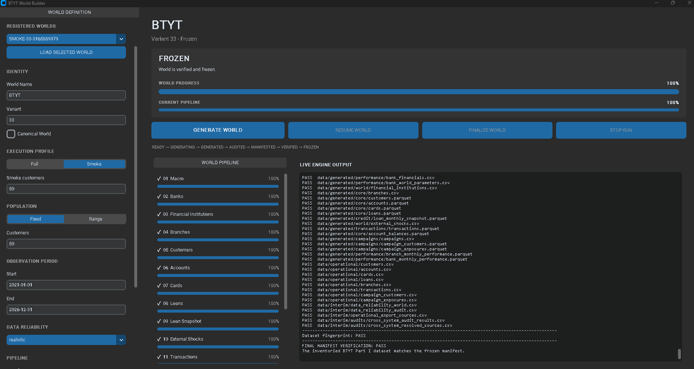
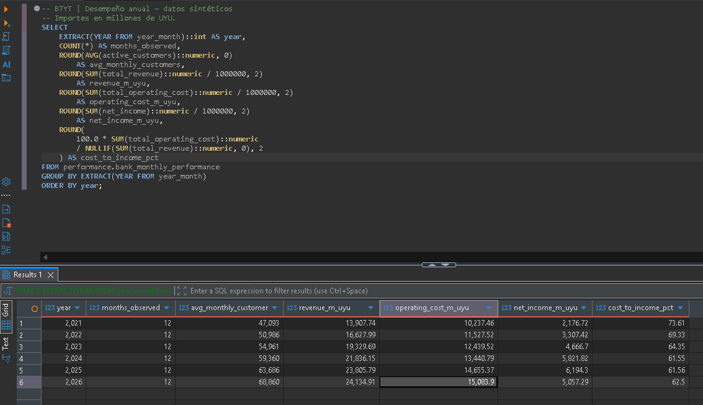
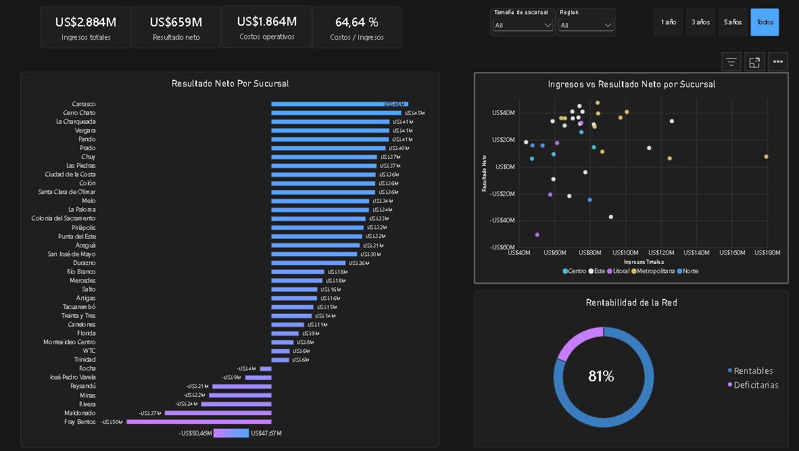
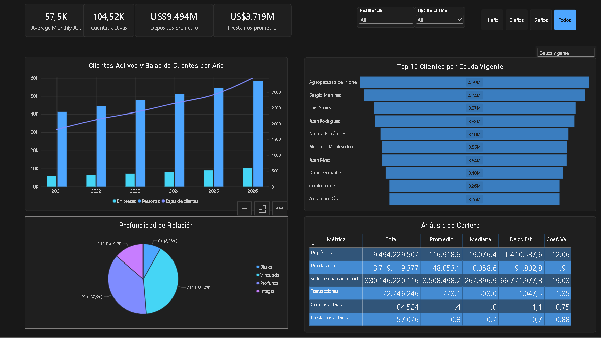
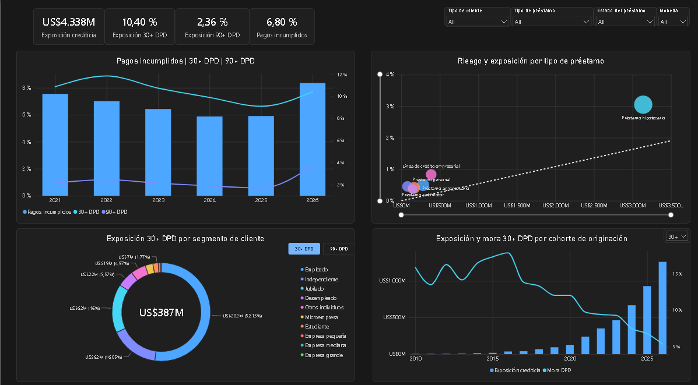
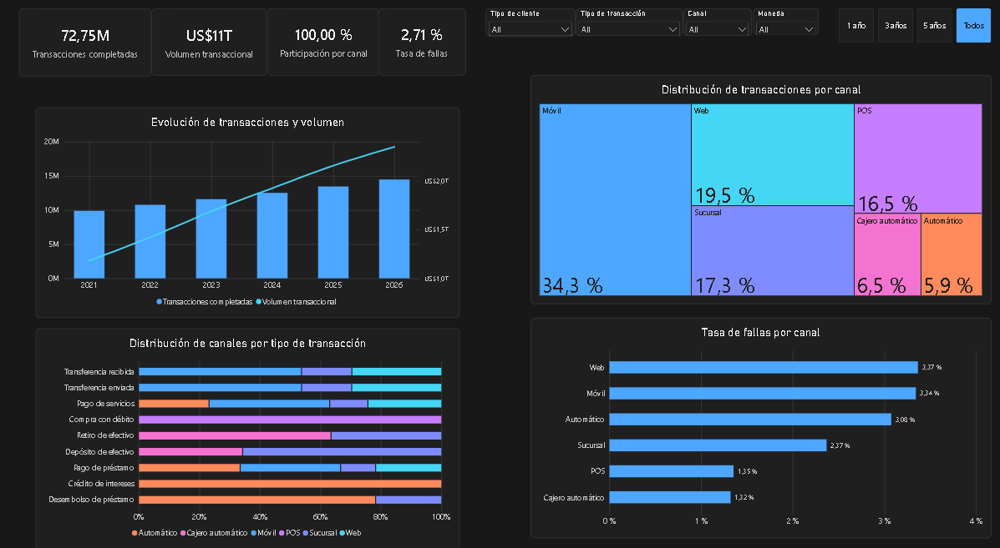
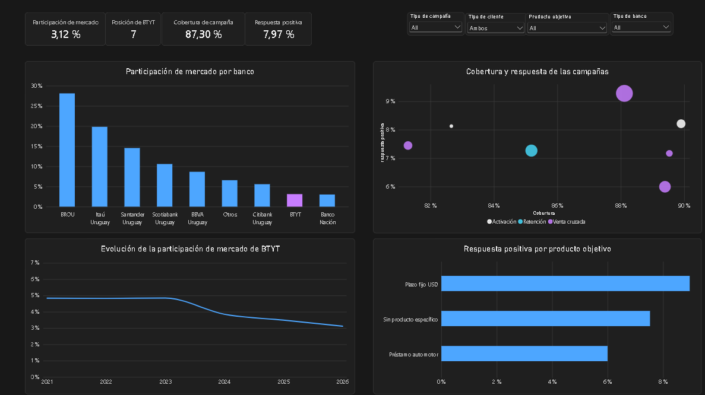

<p align="center">
  
</p>

# BTYT Banking Analytics

**End-to-end banking analytics project built around a fictional Uruguayan commercial bank.**

**Python · PostgreSQL · SQL · Power BI · DAX**

**107K customers · 37 branches · 72.75M completed transactions · 2021–2026**

> **Part I — Business Intelligence & Performance Management: Core implementation complete · Excel & Tableau extensions planned**

<p align="center">
  
</p>

BTYT is not only a dashboard. The project builds a complete synthetic banking environment and carries the data through the full analytical lifecycle:

**Synthetic banking world → Python generation & validation → PostgreSQL → SQL analytics → BI & reporting**

All data, customers, transactions, financial results and credit events are **synthetic**.

---

## End-to-end architecture

```text id="rq0q3w"
BTYT banking world
        │
        ▼
Python generation
        │
        ├── Customers
        ├── Accounts
        ├── Cards
        ├── Loans
        ├── Transactions
        ├── Credit histories
        ├── Branches
        ├── Campaigns
        └── Financial performance
        │
        ▼
Validation & World Builder
        │
        ▼
Parquet / CSV
        │
        ▼
PostgreSQL
        │
        ├── Relational model
        ├── Constraints
        ├── Analytical views
        └── Materialized aggregations
        │
        ▼
SQL analytical layer
        │
        ▼
Business Intelligence
        │
        ├── Power BI + DAX
        ├── Excel          [planned]
        └── Tableau        [planned]
```

---

## 1. Python — Building the banking universe

The first layer of BTYT is a synthetic-data generation system written in Python.

It creates a coherent banking universe with customers, products, accounts, loans, transactions, credit behavior, campaigns, branches and financial performance across **2021–2026**.

A dedicated **World Builder** is used to configure scenarios, control executions and validate generated worlds.

<p align="center">
  
</p>

The objective is to reproduce the complexity of a real analytical environment without using confidential banking information.

[Explore the World Builder](world_builder/) · [Generators](scripts/generators/) · [Validation scripts](scripts/audits/)

---

## 2. PostgreSQL & SQL — From generated data to analytics

Generated datasets are loaded into PostgreSQL, which acts as the central analytical database.

The database organizes the banking universe into domains covering:

- customers and accounts;
- cards and loans;
- transactions and balances;
- credit-risk snapshots;
- branches;
- campaigns;
- market information;
- financial performance.

SQL is then used to transform the relational model into reusable analytical views and aggregations.

<p align="center">
  
</p>

Heavy calculations are performed upstream whenever appropriate. This is especially important for the transaction layer, where tens of millions of individual events are aggregated before reaching the BI tools.

[Explore SQL analysis](scripts/sql/exploration/) · [Database workflow](docs/dbprocess/)

---

## 3. Power BI — Business Intelligence layer

Power BI is the main implemented analytical surface of Part I.

The semantic model combines PostgreSQL analytical layers with DAX measures, temporal logic, dynamic metrics and interactive filtering.

The final report contains **six business-focused pages**.

### 01 — Resumen Ejecutivo

Overall financial performance, revenue, net income, operating costs, efficiency and profitability.

<p align="center">
  
</p>

### 02 — Sucursales

Branch revenue, profitability, operating costs, regional performance and network health.

<p align="center">
  
</p>

### 03 — Clientes y Cuentas

Customer evolution, active accounts, deposits, loans, relationship depth and dynamic customer rankings.

<p align="center">
  
</p>

### 04 — Riesgo de Crédito

Credit exposure, 30+ and 90+ DPD delinquency, payment shortfalls, customer segments, loan types and origination cohorts.

<p align="center">
  
</p>

### 05 — Transacciones y Canales

Completed transactions, transaction volume, channel mix, transaction types and operational failure rates.

<p align="center">
  
</p>

### 06 — Mercado y Campañas

Market share, competitive positioning, campaign coverage, positive response and product targeting.

<p align="center">
  
</p>

---

## Analytical design

The project applies explicit analytical rules instead of treating every metric the same way:

- **Flows** such as transactions, revenue and costs are accumulated over time.
- **Stocks** such as deposits and outstanding balances use appropriate monthly-period logic.
- Monetary reporting in the BI layer is standardized in **USD** where conversion is required.
- FX conversion is applied according to the year of each observation.
- Failed transactions remain available for operational analysis but are separated from completed financial volume.
- Credit risk distinguishes between **30+ DPD** and **90+ DPD** exposure.
- Campaign response is treated as customer receptivity, not automatically as product conversion.
- Large transaction aggregations are handled in PostgreSQL rather than importing the complete raw event table into Power BI.

---

## Technology stack

| Layer | Technology |
|---|---|
| Synthetic data generation | Python |
| Data storage | Parquet / CSV |
| Database | PostgreSQL |
| Data analysis | SQL |
| Semantic modeling & BI | Power BI / DAX |
| Additional BI surfaces | Excel / Tableau — planned |
| Validation | Python / SQL |
| Version control | Git / GitHub / Git LFS |

---

## Repository

```text id="sk75bi"
BTYT Banking Analytics
│
├── config/             # project and generation configuration
├── data/               # generated analytical data
├── docs/               # technical and analytical documentation
├── manifests/          # generation manifests
├── powerbi/            # Power BI report
├── scripts/
│   ├── generators/     # synthetic-data generation
│   ├── audits/         # validations and controls
│   └── sql/            # database and analytical SQL
├── world_builder/      # synthetic-world management application
└── worlds/             # banking-world definitions
```

---

## Documentation

[Power BI](docs/powerbi/) ·
[KPI catalog](docs/analytics/kpi_catalog.md) ·
[SQL analysis](scripts/sql/exploration/) ·
[Data dictionary](docs/data_dictionary/) ·
[Database workflow](docs/dbprocess/) ·
[Full documentation](docs/README.md)

---

## Roadmap

### Part I — Business Intelligence & Performance Management

**Core end-to-end implementation complete**

Implemented:

**Python synthetic-data pipeline → PostgreSQL → SQL analytical layer → Power BI**

Planned extensions:

- **Excel** — selected KPI analysis, reporting and business-user workflows.
- **Tableau** — complementary interactive visualization and analytical storytelling.

These extensions will reuse the same analytical universe and KPI framework rather than creating a separate dataset.

### Part II — Credit Risk & Predictive Analytics

Next major analytical phase:

**feature engineering → temporal validation → predictive modeling → model evaluation → explainability → business interpretation**

---

## Author

**Santiago Castillo Marsicano**

Economics & Sociology · Data Analytics · Business Intelligence

[GitHub](https://github.com/SantiagoCMarsicano)

---

> **Disclaimer:** BTYT is a fictional bank. All customer, transaction, financial, credit-risk and campaign data are synthetic. No confidential banking information is used.