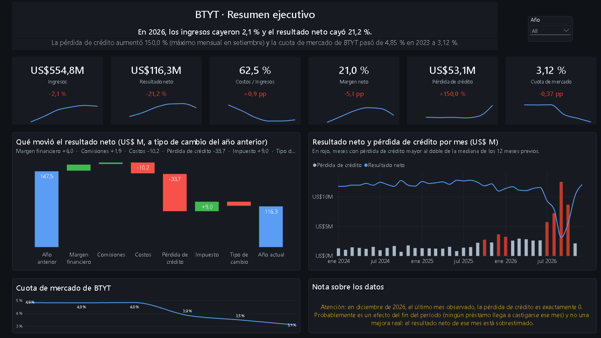
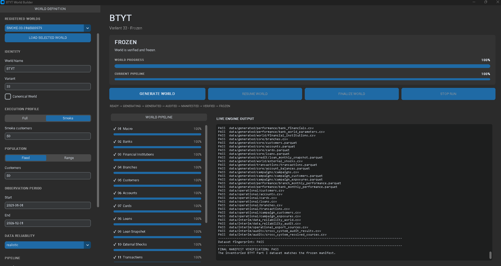
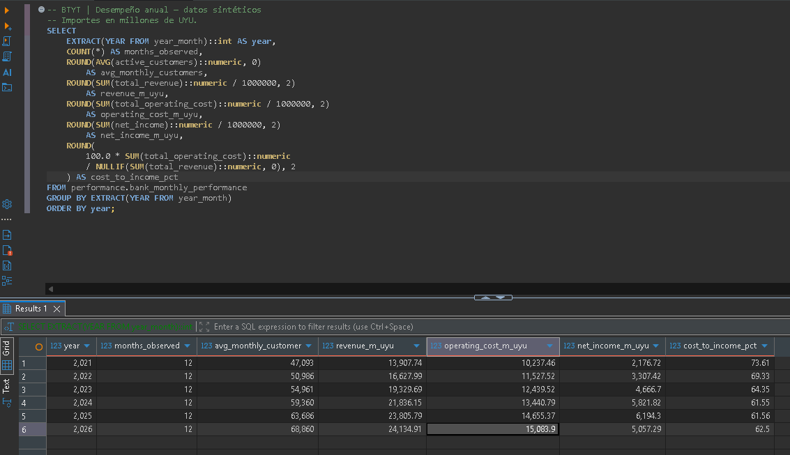
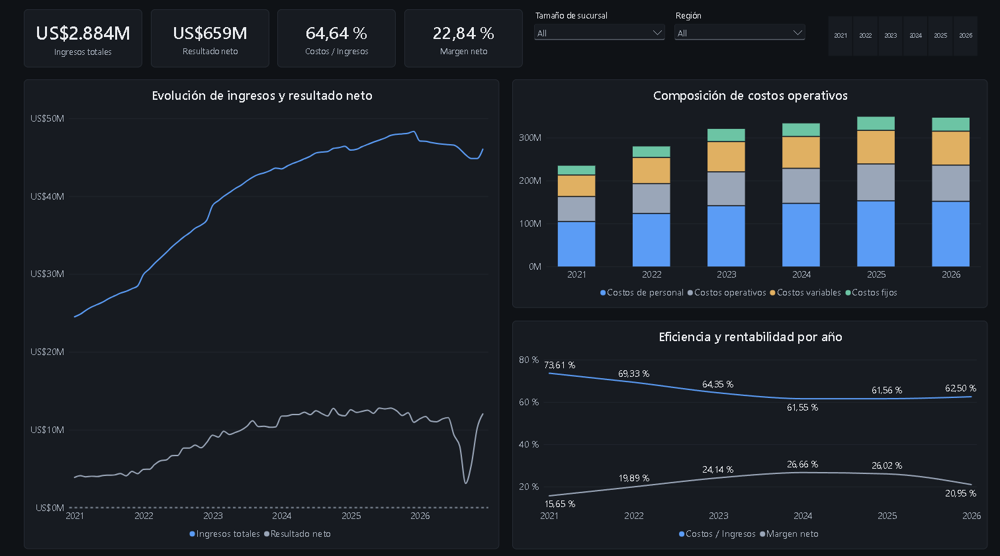
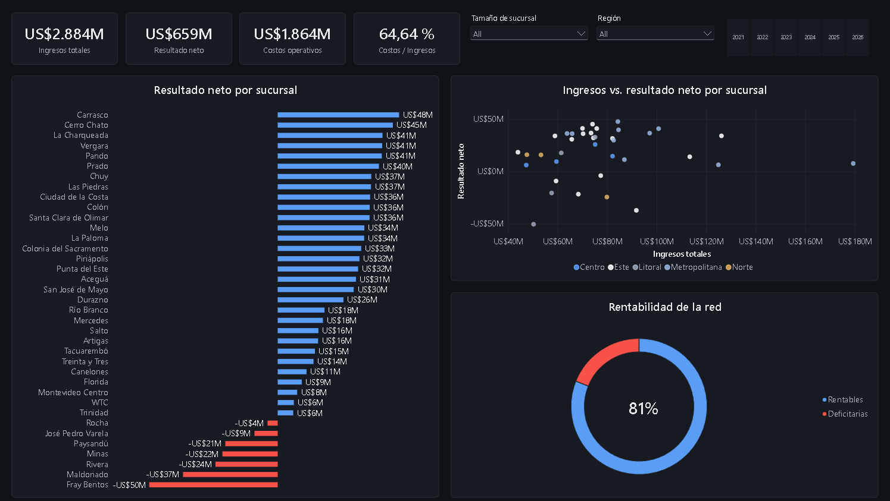
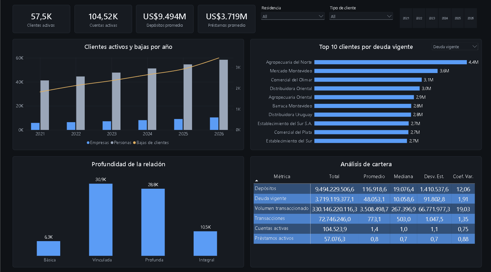
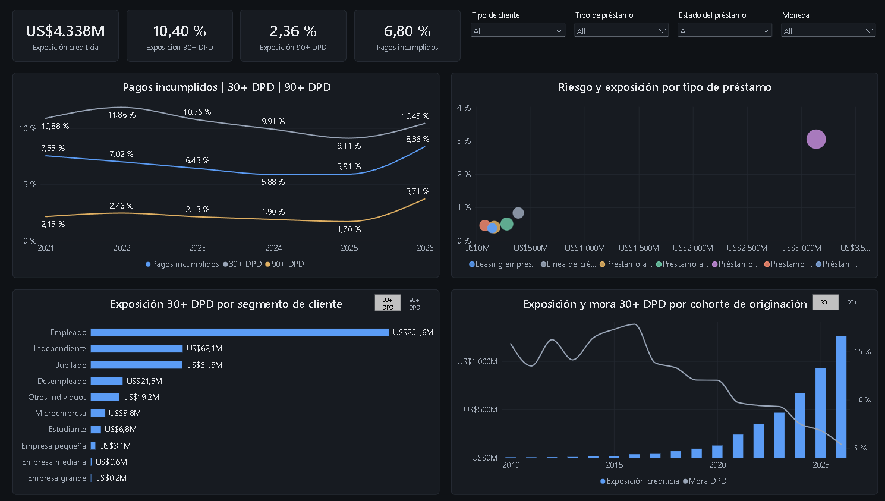
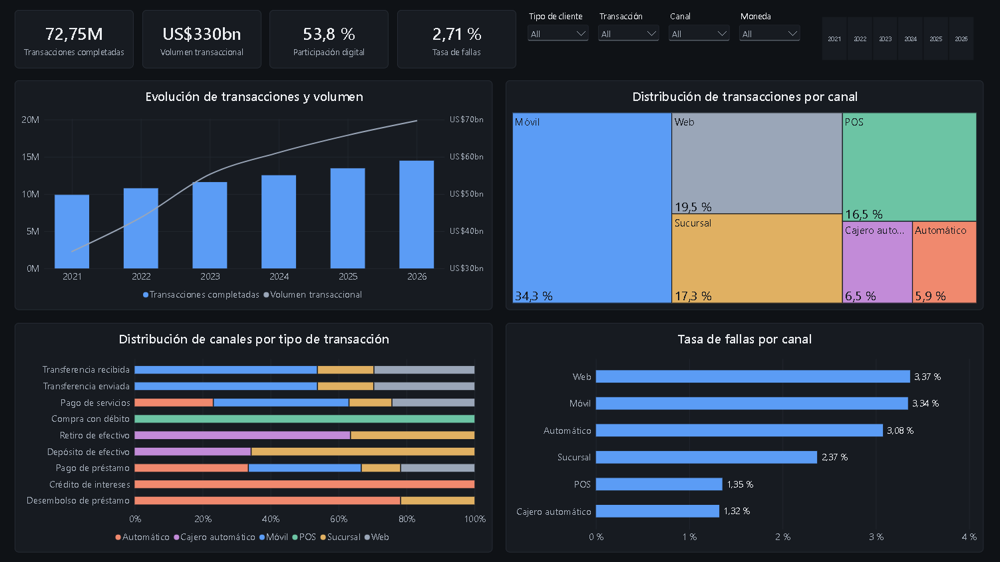
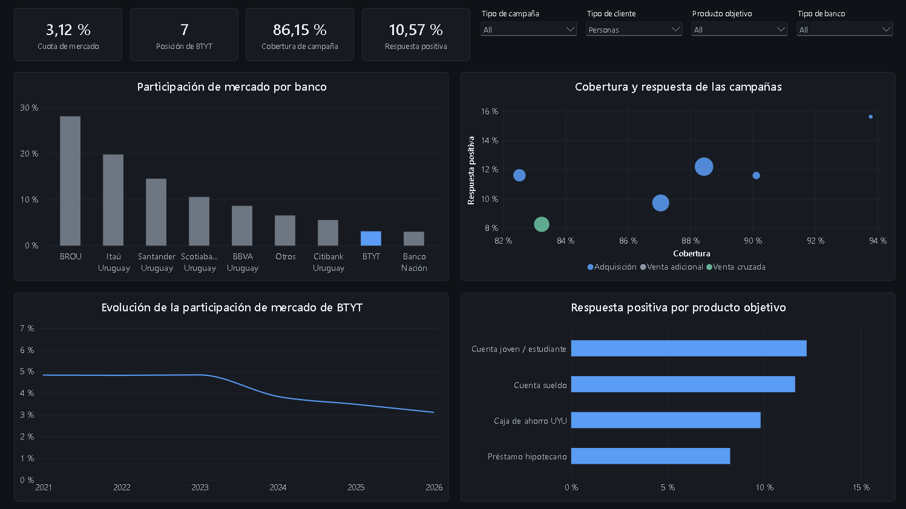

<p align="center">
  
</p>

<p align="center">
  <a href="README.md">Español</a> · <strong>English</strong>
</p>

# BTYT Banking Analytics

**End-to-end banking analytics project built around a fictional Uruguayan commercial bank.**

**Python · PostgreSQL · SQL · Power BI · DAX**

**107K customers · 37 branches · 72.75M completed transactions · 2021–2026**

> **Part I — Business Intelligence & Performance Management: Core implementation complete · Excel & Tableau extensions planned**

<p align="center">
  
</p>

BTYT is more than a dashboard. The project builds a configurable synthetic banking universe and carries its data through the complete analytical lifecycle:

**World Builder → Python generation & validation → PostgreSQL → SQL analytics → Power BI**

All banking data, transactions, financial results and credit events are **synthetic**.

---

## End-to-End Architecture

```text
World Builder
      │
      ├── World configuration
      ├── Deterministic seeds
      └── Scenario management
      │
      ▼
Python Generation
      │
      ├── Customers, accounts and cards
      ├── Loans and credit histories
      ├── Transactions and balances
      ├── Branches and campaigns
      └── Financial performance
      │
      ▼
Validation & Auditing
      │
      ▼
Parquet / CSV
      │
      ▼
PostgreSQL
      │
      ├── Relational model
      ├── Analytical views
      └── Materialized aggregations
      │
      ▼
Power BI + DAX
      │
      ├── Executive reporting
      ├── Business analysis
      └── Credit risk monitoring
```

The same banking universe supports descriptive analytics in Part I and future predictive modeling in Part II.

---

## Quick Start

The generation pipeline was tested with **Python 3.14.7 on Windows 11**.

```bash
git clone https://github.com/SantiagoCMarsicano/btyt-banking-analytics.git
cd btyt-banking-analytics
python -m venv .venv
```

Activate the virtual environment and install dependencies:

```powershell
.\.venv\Scripts\Activate.ps1
python -m pip install -r requirements.txt
```

Launch World Builder:

```bash
python -m world_builder.app
```

Create a small SMOKE world, generate the banking datasets and validate the results.

**[Complete World Builder Quick Start](world_builder/README.md#quick-start)**

To validate the active world without generating data:

```bash
python -m scripts.generate_btyt --check-only
```

PostgreSQL is **not required** to explore the source code, SQL queries, DAX measures or dashboard screenshots. Reproducing the complete analytical pipeline and refreshing Power BI requires a compatible PostgreSQL database.

---

## 1. Python — Building the Banking Universe

Instead of using a predefined banking dataset, BTYT generates interconnected customers, accounts, cards, loans, transactions, branches, campaigns and financial results.

The **World Builder** manages configurable scenarios, reproducible random seeds, pipeline execution, cross-system validation and frozen datasets.

<p align="center">
  
</p>

The canonical BTYT world is only one possible realization. Users can generate new synthetic banking scenarios using the same architecture.

[World Builder](world_builder/) · [Python generators](scripts/generators/) · [Validation scripts](scripts/audits/)

---

## 2. PostgreSQL & SQL — From Data to Analytics

PostgreSQL stores the synthetic banking universe in relational tables organized by business domain.

The analytical layer implements reusable SQL views, materialized aggregations, banking KPIs and consistency checks.

<p align="center">
  
</p>

Large transaction datasets are aggregated upstream to support efficient BI reporting without importing tens of millions of raw events into Power BI.

[SQL exploration](scripts/sql/exploration/) · [Analytical views](scripts/sql/views/) · [Database workflow](docs/dbprocess/)

---

## 3. Power BI — Business Intelligence Layer

Power BI is the main analytical interface implemented in Part I.

The report contains **seven pages**: an executive summary followed by six business-focused analytical views.

The semantic model includes **107 documented DAX measures**, an explicit date dimension, dynamic metrics, a temporal comparison calculation group and annual foreign-exchange conversion logic.

The source is versioned as a **Power BI Project (`.pbip`)**, with report definitions in PBIR JSON and semantic-model definitions in TMDL.

### 01 — Resumen ejecutivo

Year-end performance, automatic executive narrative, year-over-year KPIs, net income decomposition, credit-loss monitoring and market-share evolution.

<p align="center">
  
</p>

### 02 — Rentabilidad y costos

Revenue, net income, operating cost composition, efficiency and profitability trends.

<p align="center">
  
</p>

### 03 — Sucursales

Branch profitability, financial performance, regional comparisons and network efficiency.

<p align="center">
  
</p>

### 04 — Clientes y Cuentas

Customer evolution, account relationships, deposits, lending and portfolio distribution.

<p align="center">
  
</p>

### 05 — Riesgo de Crédito

Credit exposure, 30+ and 90+ DPD delinquency, payment shortfalls, customer segments and origination cohorts.

<p align="center">
  
</p>

### 06 — Transacciones y Canales

Completed transactions, USD-adjusted volume, digital channel participation and operational failure rates.

<p align="center">
  
</p>

### 07 — Mercado y Campañas

Market positioning, competitive share, campaign coverage and positive customer response.

<p align="center">
  
</p>

### Power BI Files

Two complementary formats are maintained:

| Format | Purpose |
|---|---|
| `.pbip` | Editable source project with PBIR report and TMDL semantic model |
| `.pbix` | Standalone Power BI Desktop file, managed through Git LFS |

Open `powerbi/BTYT_Banking_Analytics.pbip` to explore the editable project or `powerbi/BTYT_Banking_Analytics.pbix` for the standalone report.

The PBIP requires its accompanying `.Report` and `.SemanticModel` directories. Refreshing either format requires access to the PostgreSQL data source.

**[Explore the Power BI documentation](docs/powerbi/)**

---

## Analytical Design

The project applies explicit rules to maintain consistency across its analytical layers:

- **Flows:** revenue, costs and transactions are accumulated over time.
- **Stocks:** deposits, balances and credit exposure follow monthly reporting logic.
- **Currency:** UYU amounts are converted to USD using the corresponding year's exchange rate.
- **Transactions:** completed movements are distinguished from failed attempts.
- **Credit risk:** delinquency, exposure and credit losses are analyzed separately.
- **Campaigns:** positive response represents customer receptivity, not proven causal impact.

---

## Technology Stack

| Layer | Technology |
|---|---|
| Synthetic data generation | Python |
| World management | CustomTkinter |
| Data storage | Parquet / CSV |
| Database | PostgreSQL |
| Analytical processing | SQL |
| Semantic modeling & BI | Power BI / DAX / TMDL |
| Validation | Python / SQL |
| Version control | Git / GitHub |
| Power BI distribution | PBIP / PBIX / Git LFS |
| Planned BI extensions | Excel / Tableau |

---

## Documentation

[World Builder](world_builder/README.md) ·
[Power BI](docs/powerbi/) ·
[KPI Catalog](docs/analytics/kpi_catalog.md) ·
[SQL Analysis](scripts/sql/exploration/) ·
[Data Dictionary](docs/data_dictionary/) ·
[Database Workflow](docs/dbprocess/) ·
[Full Documentation](docs/README.md)

---

## Roadmap

### Part I — Business Intelligence & Performance Management

**Core implementation complete.**

Python synthetic-data generation → PostgreSQL → SQL analytical layer → Power BI.

**Planned extensions:** Excel and Tableau, reusing the same banking universe and KPI framework.

### Part II — Credit Risk & Predictive Analytics

Feature engineering → temporal validation → statistical and machine-learning models → evaluation → explainability → business interpretation.

Part II will reuse the existing synthetic banking universe rather than introduce an unrelated dataset.

---

## Author

**Santiago Castillo Marsicano**

Economics & Sociology · Data Analytics · Business Intelligence

[GitHub](https://github.com/SantiagoCMarsicano)

---

> **Disclaimer:** BTYT is a fictional bank. All customer, transaction, financial, credit-risk, market and campaign data are synthetic. No confidential banking information is used.