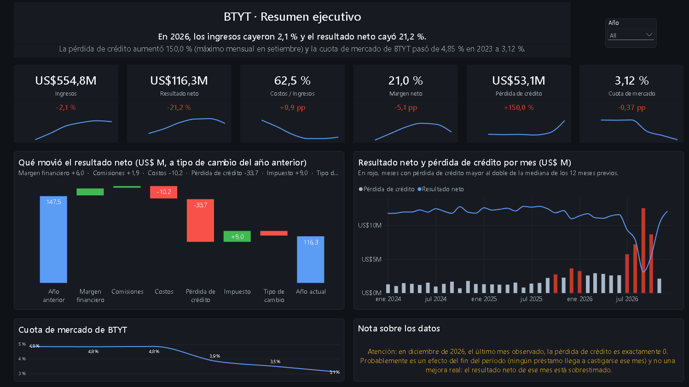

# Resumen ejecutivo, modelo y tema

Página de apertura para una reunión de cierre de año y cambios del modelo semántico que la sostienen.

<p align="center">
  
</p>

## Piezas en el repositorio

| Pieza | Ubicación |
|---|---|
| Proyecto Power BI | `powerbi/BTYT_Banking_Analytics.pbip` (informe PBIR + modelo TMDL) |
| Tema | `powerbi/themes/BTYT_Oscuro.json` (también `BTYT_Corporativo.json`, claro) |
| Generador del tema | `scripts/dashboard/build_powerbi_theme.py` |
| Generador de la página | `scripts/dashboard/build_executive_summary_page.py` |
| Medidas | tabla `_Measures`, carpeta **Resumen Ejecutivo** (Indicadores, Colores, Textos, Gráficos) |

Los scripts escriben archivos del proyecto `.pbip`: Power BI Desktop tiene que estar cerrado al ejecutarlos.

```bash
python scripts/dashboard/build_executive_summary_page.py                    # vista previa
python scripts/dashboard/build_executive_summary_page.py --apply --replace  # regenerar la página
```

## Contenido de la página

- **Titular automático** en dos líneas: ingresos y resultado neto del año analizado; causas (pérdida de crédito, mes pico) y cuota de mercado.
- **Seis indicadores**: valor del año, variación contra el año anterior (verde si mejora, rojo si empeora) y tendencia de seis años.
- **Puente del resultado neto**: cada partida a tipo de cambio del año anterior y el efecto cambiario aparte. Barras apiladas con una base invisible: años en azul, aumentos en verde, bajas en rojo. El subtítulo lista todas las variaciones.
- **Resultado neto y pérdida de crédito por mes**: en rojo, los meses con pérdida mayor al doble de la mediana de los 12 meses previos.
- **Cuota de mercado de BTYT** y **nota sobre los datos** (aviso automático cuando el último mes tiene pérdida de crédito 0).

El año analizado es el último con datos dentro del filtro (`Exec Current Year`). El selector de año no filtra las tendencias.

## Modelo semántico

- **Grupo de cálculo `Comparación temporal`**: Actual, Año anterior, Variación y Variación %. Las medidas `Exec … PY`, `YoY %` y `Change (pp)` lo usan en lugar de repetir lógica de fechas.
- **Tipo de cambio**: una sola columna `DimDate[UYU per USD]`; las medidas monetarias la consultan en vez de tener tasas escritas a mano.
- **Relaciones de fecha**: `Market Performance` (columna `Year Date`, 31/12 de cada año) y `Campaign Performance[start_date]` se relacionan con `DimDate`.
- **Sin agregaciones implícitas** (`discourageImplicitMeasures`): todo visual usa una medida explícita.
- **Carpetas y descripciones**: las 107 medidas están agrupadas por área y tienen descripción en español.
- **Rankings anónimos**: `Customer Accounts[Customer Display]` muestra la razón social de las empresas y "Cliente + ID" para personas.

## Notas de DAX

- `Before` y `Levels` son palabras reservadas (funciones de ventana): no usarlas como nombres de variable.
- Al guardar desde Power BI Desktop se descartan las propiedades de formato que el visual no reconoce; conviene revisar el diff después de cada guardado.
